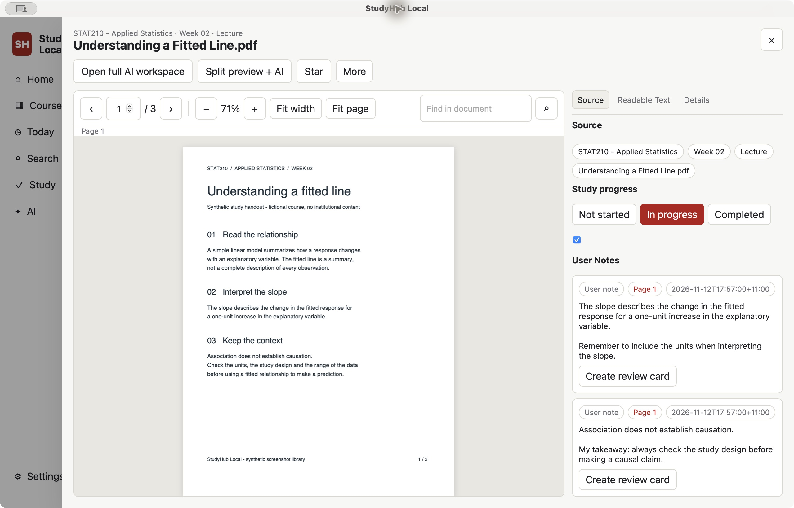
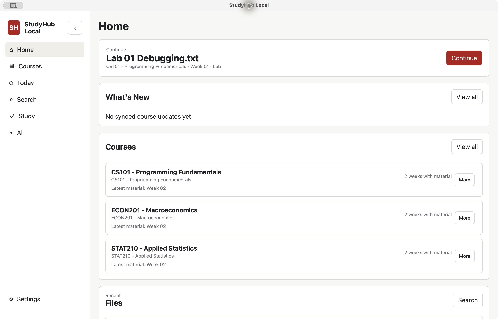
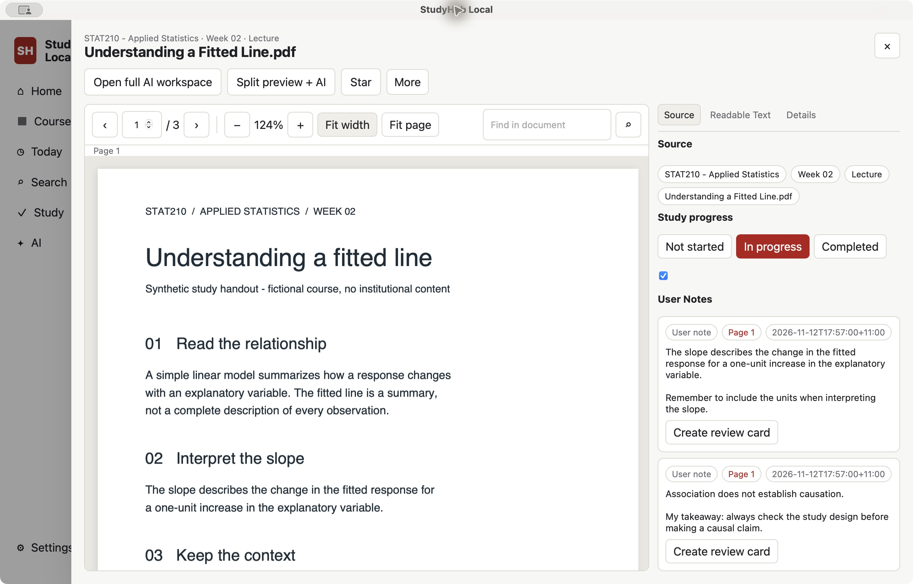
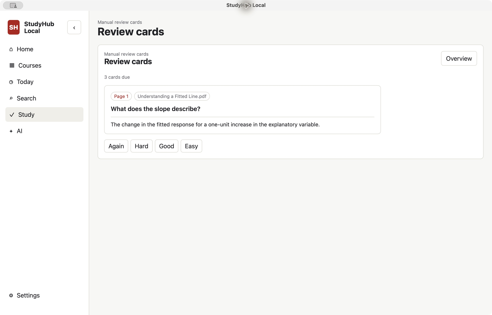
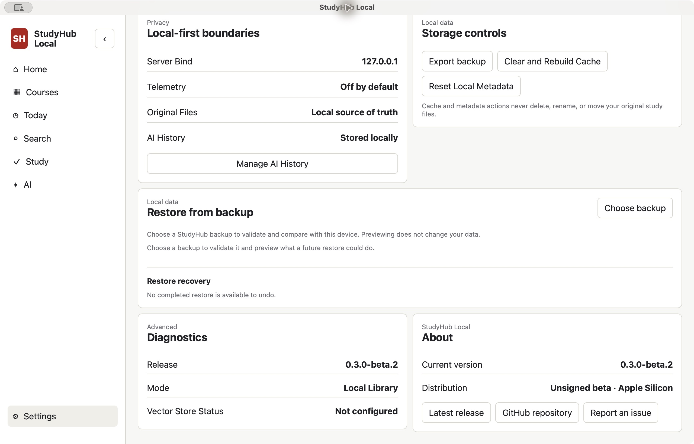

# StudyHub Local

[](https://github.com/langming58-hash/studyhub-local/releases/tag/v0.3.0-beta.2)
[](LICENSE)
[](https://github.com/langming58-hash/studyhub-local/actions/workflows/ci.yml)


[简体中文](README.zh-CN.md)

Read your course PDFs, keep notes linked to their sources, and review what you learn—all on your Mac. StudyHub Local is an open-source, local-first study workspace; Canvas and AI are optional.

**[Download beta.2 for macOS](https://github.com/langming58-hash/studyhub-local/releases/tag/v0.3.0-beta.2)** · [Release notes](docs/releases/v0.3.0-beta.2.md) · [Source code](https://github.com/langming58-hash/studyhub-local)

Apple Silicon only · macOS 13+ · Prerelease · **Unsigned beta** (ad-hoc signed), not Apple notarized.



## From reading to review

| | |
| --- | --- |
| **Home and courses**<br>[](docs/assets/screenshots/beta2-home-dashboard.jpg) | **Source-linked notes and saved excerpts**<br>[](docs/assets/screenshots/beta2-source-linked-notes-excerpts.jpg) |
| **Manual FSRS Review Cards**<br>[](docs/assets/screenshots/beta2-manual-fsrs-review-cards.jpg) | **Local Data and Export Backup**<br>[](docs/assets/screenshots/beta2-local-data-export-backup.jpg) |

Real native screenshots of the published beta.2 app, using a separate synthetic
study library and isolated profile. All courses, materials, notes and cards are
fictional; no live Canvas account or AI credentials are shown. Click an image
to inspect it. [Capture provenance and privacy review](docs/assets/screenshots/README.md).

## Included in beta.2

- **PDF Reader V1:** page navigation, find, zoom and fit-width / fit-page.
- **Source-linked Notes and PDF Text Excerpts:** keep saved notes and excerpts connected to the source page and material version.
- **Manual FSRS Review Cards:** author your own cards, follow source-page links and review with local scheduling.
- **Canvas OAuth, Assignments and Today:** optional, institution-authorized, read-only Canvas connection; local study and review remain available without it.
- **Local backup export, Restore Preview, Apply and Undo:** portable user-owned study state with validated, bounded restore operations.
- Local organization and search, English / Simplified Chinese, optional source-grounded AI, and a bundled local backend.

PDF Highlights from unmerged PR #44 are excluded. Seven core macOS learning
workflows have passed user testing, as reported by the maintainer. **Full
real-GUI backup save/restore/undo acceptance remains incomplete.** The Export
Backup screenshot shows the available control; it is not full workflow
acceptance evidence. This is a prerelease, not a stable production release.

## Install on macOS

1. Open the [GitHub Release](https://github.com/langming58-hash/studyhub-local/releases/tag/v0.3.0-beta.2) and download `StudyHub-Local-v0.3.0-beta.2-macos-arm64.dmg` and its matching `.sha256`.
2. Open the DMG and drag **StudyHub Local** to **Applications**.
3. Launch the app normally.
4. If Gatekeeper blocks the first launch, open **System Settings → Privacy & Security → Open Anyway** for StudyHub Local. Do not disable Gatekeeper.

The backend is bundled. Git, Python, Node.js, Rust and npm are not needed by end
users. Terminal is not required for installation or first launch. Optional
checksum instructions and compatibility limits are in the [release notes](docs/releases/v0.3.0-beta.2.md).

Original files stay in a folder you control. First launch is an empty workspace;
the gallery's synthetic study library is not bundled. Backups exclude original
academic files and credentials, so keep separate copies of your originals.
Canvas requires an institutionally provisioned OAuth client. AI is optional;
enabling cloud AI/indexing sends selected content to the configured provider.

## Source Development Requirements

- Git, Node.js/npm, and Python 3
- Poppler (`pdftotext` and `pdfinfo`) recommended for PDF text extraction
- LibreOffice optional for higher-fidelity PowerPoint and Word previews

## Quick Start

```bash
git clone https://github.com/langming58-hash/studyhub-local.git
cd studyhub-local
npm install
python3 -m pip install -r requirements.txt
npm run dev
```

Open the printed loopback URL, usually `http://127.0.0.1:8765`. On first launch, create a course or import an existing course folder. StudyHub does not scan unrelated folders automatically.

On macOS, `Start StudyHub Local.command` is a convenience launcher for source development. Most users should install the DMG above.

## Study Library

Keep real study files outside the repository. A typical structure is:

```text
~/StudyLibrary/
├── CS101 - Programming Fundamentals/
│   ├── Week 01/
│   │   ├── 01 Course Materials/Lecture/
│   │   └── 02 Exercises/Tutorial/
│   └── Week 02/
└── ECON201 - Macroeconomics/
```

Common formats include PDF, DOCX, PPTX, TXT, CSV, Python, R, and IPYNB where local extraction support is available. Original files remain authoritative and are never converted into unrelated study formats.

## Optional OpenAI

OpenAI is server-side and optional. Create `.env.local` only on your own machine:

```text
OPENAI_API_KEY=
OPENAI_MODEL=gpt-5.4
```

Never place keys in frontend code, screenshots, logs, issues, or commits. AI uses the narrowest reasonable context first: current question, file, week, then course. If sources do not support an answer, StudyHub returns a no-source response instead of inventing course content. Vector search is an optional retrieval layer; the local original file remains the source of truth.

## Privacy And Security

- Loopback-only by default, with no telemetry by default
- Host, exact same-origin, CSRF, request-size, and file-root checks
- Runtime databases, extracted text, previews, logs, secrets, and study files stay out of Git
- Read-only MCP boundary for local integrations
- Privacy and security acceptance suites run in normal CI

Read the [Engineering Constitution](docs/ENGINEERING_CONSTITUTION.md),
[SECURITY.md](SECURITY.md), [Privacy](docs/PRIVACY.md), and
[Architecture](docs/ARCHITECTURE.md) before changing trust boundaries.

## Development

Synthetic fixtures live only under `tests/fixtures/` and are injected by tests. They must never be bundled into production resources.

```bash
npm run ci
npm run desktop:check
```

Desktop build and packaged acceptance:

```bash
npm run desktop:setup
npm run desktop:build
npm run desktop:test:packaged
```

See [Development](docs/DEVELOPMENT.md), [Desktop Architecture](docs/DESKTOP_ARCHITECTURE.md),
[Design and Interaction](docs/design/DESIGN_SYSTEM_PLAN.md), and
[Contributing](CONTRIBUTING.md).

## License

[MIT](LICENSE)
