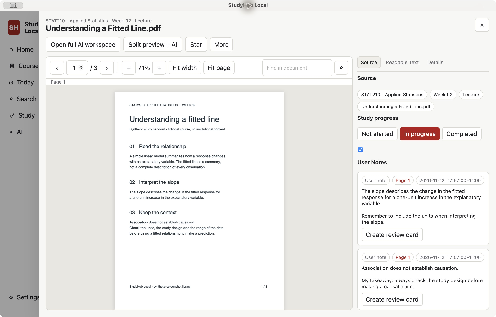
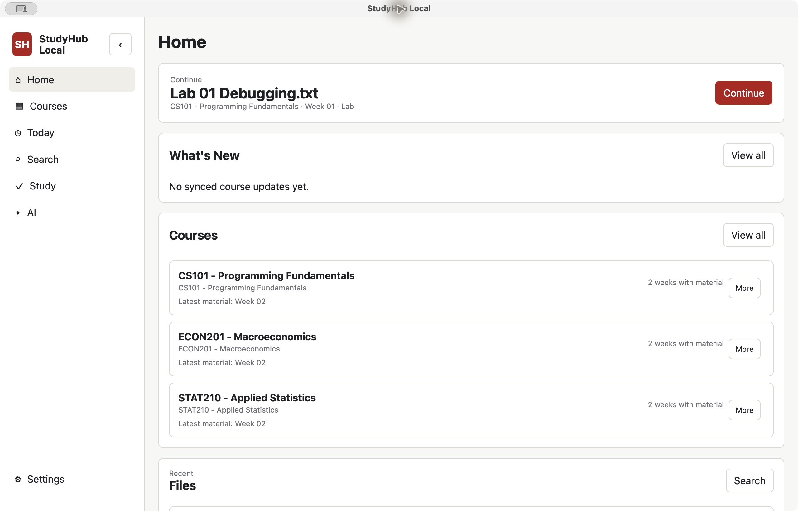
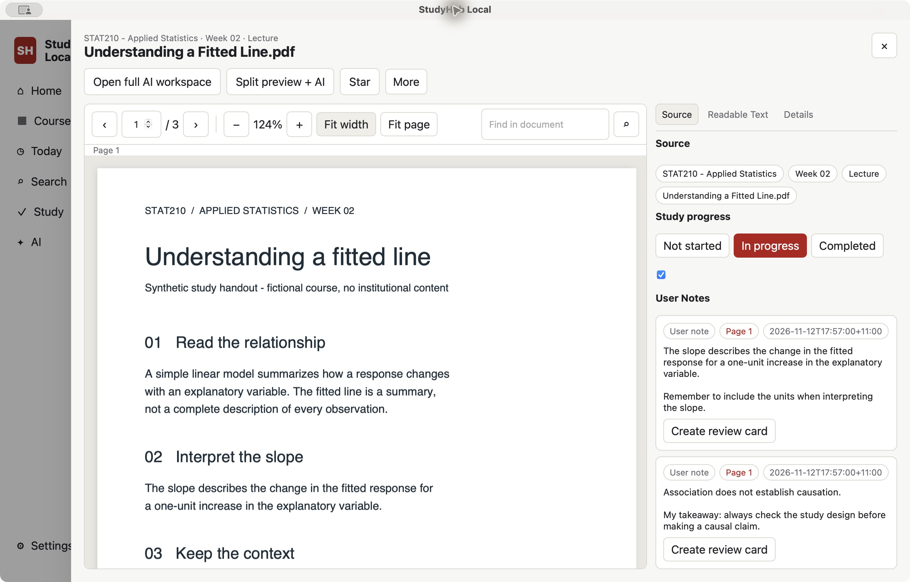
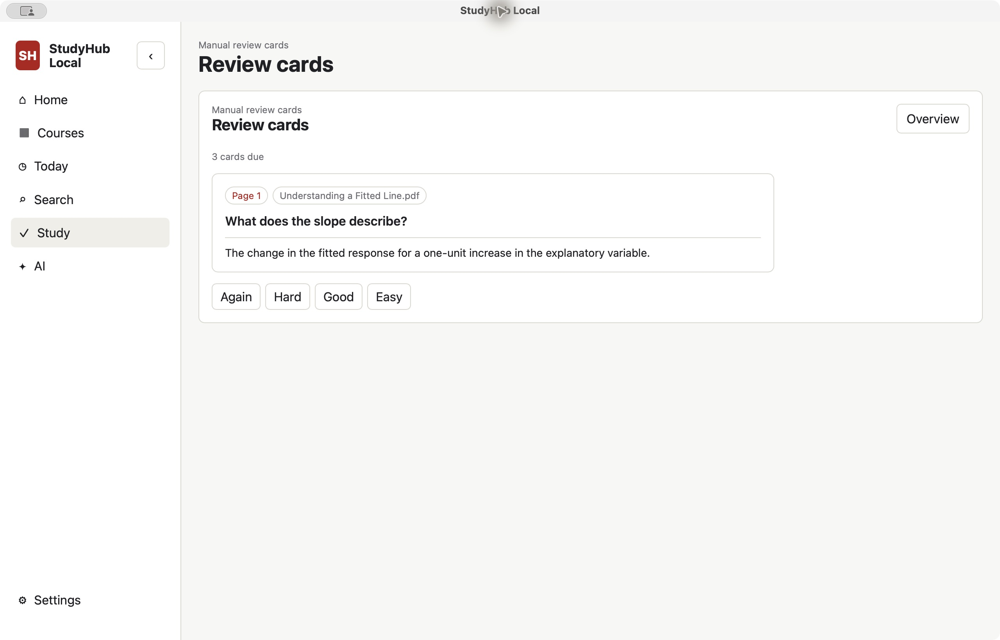
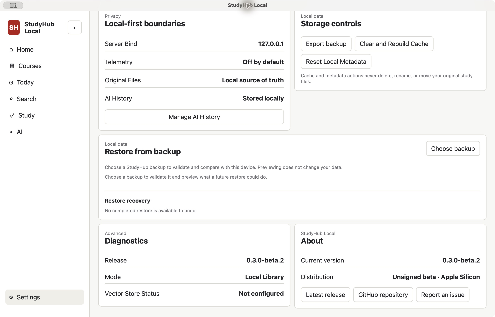

# StudyHub Local

[](https://github.com/langming58-hash/studyhub-local/releases/tag/v0.3.0-beta.2)
[](LICENSE)
[](https://github.com/langming58-hash/studyhub-local/actions/workflows/ci.yml)

[English](README.md)

在 Mac 上阅读课程 PDF、保存关联来源的笔记，再用复习卡片巩固所学。StudyHub Local 是一个开源、本地优先的学习工作区；Canvas 和 AI 都是可选功能。

**[下载 macOS beta.2](https://github.com/langming58-hash/studyhub-local/releases/tag/v0.3.0-beta.2)** · [发布说明](docs/releases/v0.3.0-beta.2.md) · [源代码](https://github.com/langming58-hash/studyhub-local)

仅 Apple Silicon · macOS 13+ · 预发布测试版 · 仅 ad-hoc 签名，未使用 Developer ID 签名或 Apple 公证。



## 从阅读到复习

| | |
| --- | --- |
| **首页与课程**<br>[](docs/assets/screenshots/beta2-home-dashboard.jpg) | **来源关联笔记与已保存摘录**<br>[](docs/assets/screenshots/beta2-source-linked-notes-excerpts.jpg) |
| **手动 FSRS 复习卡片**<br>[](docs/assets/screenshots/beta2-manual-fsrs-review-cards.jpg) | **本地数据与导出备份**<br>[](docs/assets/screenshots/beta2-local-data-export-backup.jpg) |

这些是已发布 beta.2 App 的真实原生窗口截图，使用独立的合成学习资料库和隔离配置。
课程、资料、笔记和卡片均为虚构内容，没有真实 Canvas 账户或 AI 凭证。点击图片可查看原图。
[截图来源与隐私检查记录](docs/assets/screenshots/README.md)。

## beta.2 已包含

- **PDF Reader V1：**跳页、查找、缩放、适应宽度与整页。
- **来源关联笔记与 PDF 文本摘录：**保存的笔记和摘录可关联来源页码及资料版本。
- **手动 FSRS 复习卡片：**自己编写卡片、返回来源页面，并使用本地调度进行复习。
- **Canvas OAuth、作业与 Today：**可选的学校授权只读连接；不连接也能使用本地学习与复习。
- **本地备份导出、恢复预览、应用和撤销：**导出支持的用户学习状态，并按验证范围恢复。
- 本地整理与搜索、English / 简体中文、可选的来源关联 AI，以及内置本地后端。

不包含尚未合并的 PR #44 PDF Highlights。维护者报告七项 macOS 核心学习流程已通过用户测试。
**完整的真实 GUI 备份保存、恢复和撤销验收仍未完成。** 导出备份截图展示可用的按钮，
不能作为完整流程通过验收的证据。这是预发布测试版，不是稳定生产版本。

## 在 macOS 安装

1. 打开 [GitHub Release](https://github.com/langming58-hash/studyhub-local/releases/tag/v0.3.0-beta.2)，下载 `StudyHub-Local-v0.3.0-beta.2-macos-arm64.dmg` 和匹配的 `.sha256`。
2. 打开 DMG，将 **StudyHub Local** 拖入 **Applications（应用程序）**。
3. 正常启动 App。
4. 如果 Gatekeeper 阻止首次启动，打开 **系统设置 → 隐私与安全性 → 仍要打开**。不要关闭 Gatekeeper。

这里的“未签名测试版”指仅 ad-hoc 签名，没有 Developer ID 签名或 Apple 公证。
App 已内置后端，普通用户无需 Git、Python、Node.js、Rust、npm 或终端。
校验方式及兼容性限制见[发布说明](docs/releases/v0.3.0-beta.2.md)。

原始文件保留在自己控制的文件夹里。第一次启动是空工作区，截图中的合成资料库不会随 App 分发。
备份不包含原始课程文件或凭证，请单独保留原始文件。Canvas 需要学校配置 OAuth 客户端；
AI 为可选功能，启用云端 AI 或索引会将选中的内容发送给所配置的提供商。

## 源码开发环境要求

- Git、Node.js/npm 和 Python 3
- 建议安装 Poppler（`pdftotext`、`pdfinfo`），用于提取 PDF 正文
- 可选安装 LibreOffice，用于更高保真的 PowerPoint / Word 预览

## 快速开始

```bash
git clone https://github.com/langming58-hash/studyhub-local.git
cd studyhub-local
npm install
python3 -m pip install -r requirements.txt
npm run dev
```

打开终端输出的本机地址，通常是 `http://127.0.0.1:8765`。第一次打开后，新建课程或导入已有课程文件夹。StudyHub 不会自动扫描无关文件夹。

macOS 上的 `Start StudyHub Local.command` 只是源码开发的便捷启动器。普通用户应使用上方 DMG。

## 学习资料库

真实学习资料必须放在仓库外。推荐结构示例：

```text
~/StudyLibrary/
├── CS101 - Programming Fundamentals/
│   ├── Week 01/
│   │   ├── 01 Course Materials/Lecture/
│   │   └── 02 Exercises/Tutorial/
│   └── Week 02/
└── ECON201 - Macroeconomics/
```

在本机提取依赖可用时，常见支持格式包括 PDF、DOCX、PPTX、TXT、CSV、Python、R 和 IPYNB。原文件始终是权威来源，不会被转换成与课程无关的格式。

## 可选 OpenAI

OpenAI 集成只在服务端运行，而且完全可选。只在你自己的电脑上创建 `.env.local`：

```text
OPENAI_API_KEY=
OPENAI_MODEL=gpt-5.4
```

不要把 key 放入前端代码、截图、日志、Issue 或 Git 提交。AI 默认使用最窄的合理范围：当前题目、当前文件、当前周次、当前课程。如果索引资料不足以支持回答，StudyHub 会返回“没有来源”，不会编造课程内容。Vector Search 只是可选检索层，本地原始文件始终是唯一权威来源。

## 隐私与安全

- 默认只监听 loopback 本机地址，默认无遥测
- 校验 Host、精确 same-origin、CSRF、请求大小与文件根目录边界
- 运行数据库、提取文本、预览缓存、日志、密钥和学习资料不会进入 Git
- MCP 仅提供本地只读边界
- 正常 CI 会运行隐私与安全验收套件

更改信任边界前，请阅读 [工程总纲](docs/ENGINEERING_CONSTITUTION.md)、
[SECURITY.md](SECURITY.md)、[隐私说明](docs/PRIVACY.md) 和 [架构说明](docs/ARCHITECTURE.md)。

## 开发

合成测试夹具只允许放在 `tests/fixtures/` 下，并由测试临时注入，不能进入生产资源或桌面 app bundle。

```bash
npm run ci
npm run desktop:check
```

桌面原型构建与打包验收：

```bash
npm run desktop:setup
npm run desktop:build
npm run desktop:test:packaged
```

另见 [开发说明](docs/DEVELOPMENT.md)、[桌面架构](docs/DESKTOP_ARCHITECTURE.md)、
[设计与交互](docs/design/DESIGN_SYSTEM_PLAN.md) 和 [贡献指南](CONTRIBUTING.md)。

## License

[MIT](LICENSE)
