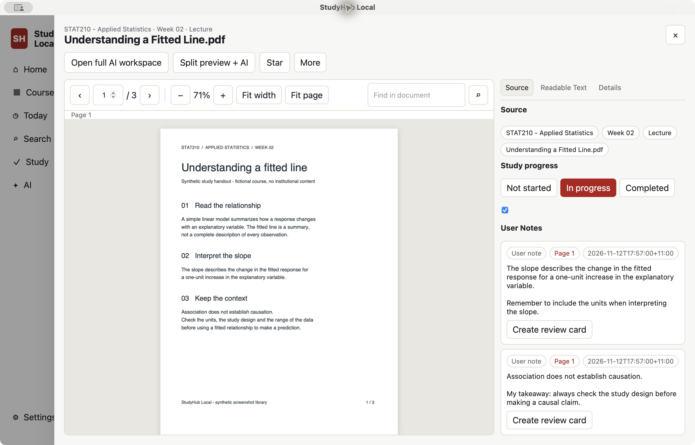
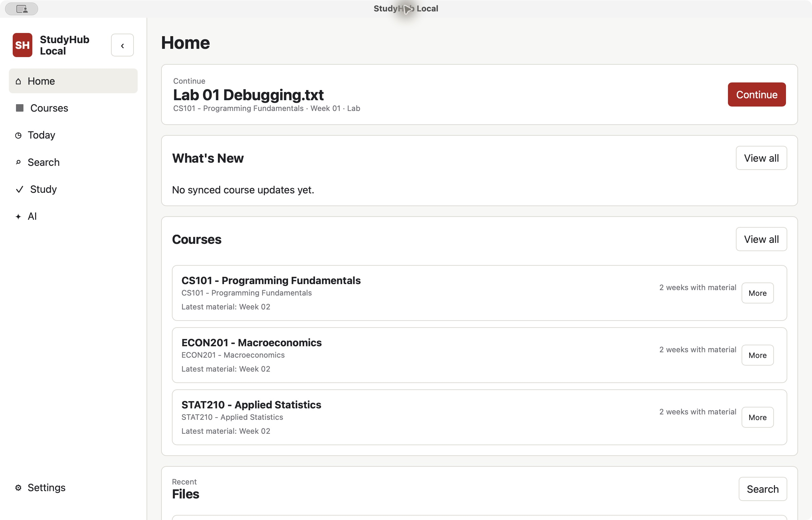
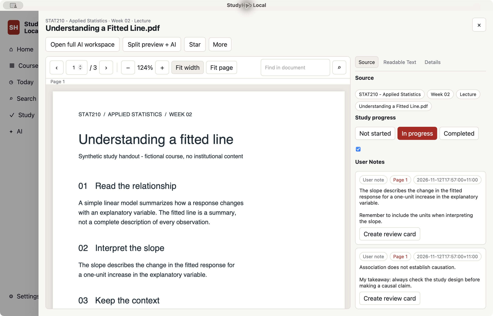
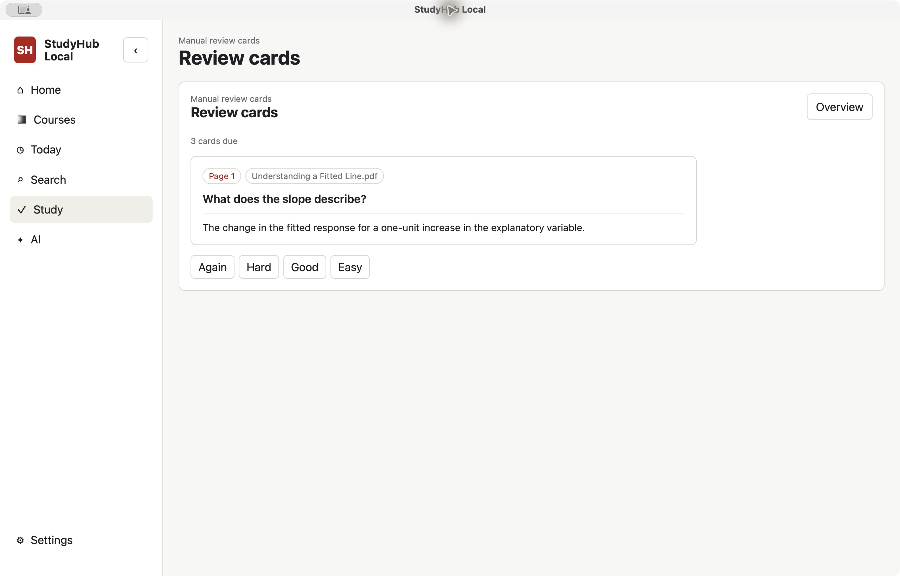
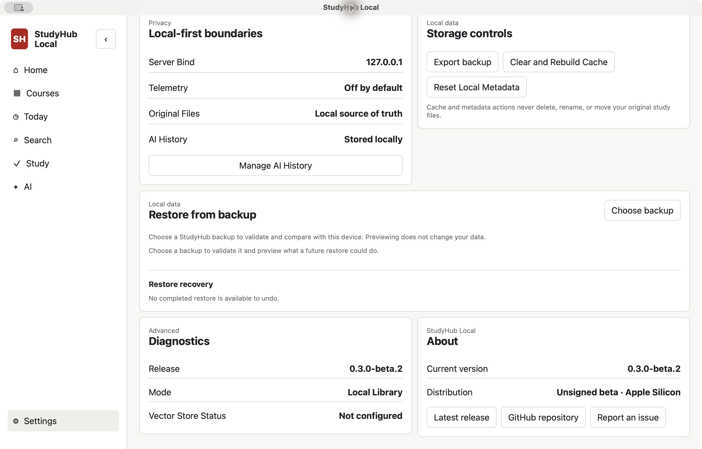

# StudyHub Local v0.3.0-beta.2

**Published macOS prerelease.** Read course PDFs, keep source-linked notes and
review user-authored cards locally. Canvas and AI are optional.
This is a prerelease, not a stable production release. It includes only features
merged into main; the existing v0.3.0-beta.1 Release remains unchanged.

## Included

- **PDF Reader V1:** locally bundled PDF.js, selectable text, find, page
  navigation, zoom, fit-width, lazy rendering and route restoration.
- **Source-linked Notes:** notes can retain a material/version/page anchor and
  navigate back to their source; stale source anchors are surfaced safely.
- **PDF Text Excerpts:** save selected PDF text into source-linked notes with
  page provenance and source-version validation. Originals are not modified.
- **Manual FSRS Review Cards:** user-authored question/answer cards, optional
  source-page links, local scheduling and review sessions. Includes the merged
  fix that clears the review-session busy state after grading errors.
- **Canvas OAuth, Assignments and Today:** institution-authorized OAuth with
  native credential storage, read-only course/file discovery and explicit file
  acquisition, assignment metadata and a local Today queue. No Canvas writes.
- **Local backup export:** Settings > Local Data > Export Backup uses the
  existing portable ZIP exporter and a native save dialog.
- **Restore Preview, Apply and Undo:** validate an archive, preview supported
  changes, explicitly apply them and undo a still-safe restore. Relinking
  requires an explicitly selected matching original.
- Existing local organization, search, optional source-grounded AI, bundled
  backend and English / Simplified Chinese UI remain available.

**Excluded:** persistent PDF Highlights from [unmerged PR #44](https://github.com/langming58-hash/studyhub-local/pull/44).
PDF text selection and excerpts do not imply persistent highlight overlays.

## Product screenshots

Actual beta.2 native windows, captured with an isolated synthetic library.
All course content, notes and cards are fictional; no live Canvas account or
AI credentials are shown. These are screenshots, not mockups.

### PDF Reader V1



The synthetic handout in the real Reader.

### Home dashboard



Fictional local courses and the resume workflow.

### Source-linked Notes / PDF Text Excerpts



Saved page-linked excerpt notes beside their source PDF.

### Manual FSRS Review Cards



A user-authored card with source-page link, revealed answer and review grades.

### Settings / Local Data / Export Backup



The available Export Backup control. Full real-GUI backup save/restore/undo acceptance remains incomplete.

[Capture provenance and limitations](https://github.com/langming58-hash/studyhub-local/blob/7b9a4ad06ad582f09babe1d76bc3378593791dd5/docs/assets/screenshots/README.md).

## Download and install

Download `StudyHub-Local-v0.3.0-beta.2-macos-arm64.dmg` and
`StudyHub-Local-v0.3.0-beta.2-macos-arm64.dmg.sha256` from this Release's assets.

1. Open the DMG.
2. Drag **StudyHub Local** to **Applications**.
3. Try to open the app normally.
4. If Gatekeeper blocks the first launch, open **System Settings > Privacy &
   Security** and choose **Open Anyway** for StudyHub Local. Do not disable
   Gatekeeper.

The local backend is bundled. Git, Python, Node.js, Rust, npm and Terminal are
not required for installation or normal use.

Optional checksum verification: save both assets in the same directory, open
Terminal in that directory and run:

```sh
shasum -a 256 -c StudyHub-Local-v0.3.0-beta.2-macos-arm64.dmg.sha256
```

The result must be `StudyHub-Local-v0.3.0-beta.2-macos-arm64.dmg: OK`.
A checksum verifies download integrity; it does not provide Apple notarization.

## Compatibility and limitations

- **Apple Silicon only (`arm64`); macOS 13 Ventura or later.** Intel Macs,
  Windows and Linux packages are not included. Broad clean-machine compatibility
  is not established by the automated build.
- **Ad-hoc signing only:** no Developer ID signature and not Apple notarized.
  First-run Gatekeeper approval may be necessary.
- **User-testing boundary:** seven core macOS learning workflows have passed
  user testing, as reported by the maintainer. Full real-GUI backup
  save/restore/undo acceptance remains incomplete. Automated API, frontend,
  Rust and packaged checks are not human GUI validation.
- **Backup scope:** the version-2 portable format preserves supported
  user-owned study state, notes and manual review cards. It excludes original
  academic files, Canvas-retained bytes, credentials, extracted text, indexes
  and caches. AI history and Canvas connector selection are not portable in
  this contract. Keep separate copies of your original files. Backups are
  unencrypted and may contain private notes; do not attach them to public issues.
  Restore supports format versions 1 and 2; relinking and Undo are bounded by
  validation and later changes. Redo, automatic relinking, cloud backup and
  scheduled backups are not implemented.
- **Canvas:** an institutionally provisioned OAuth client is required.
  Production manual-token enrollment is disabled. Unconfigured Canvas does not
  block local use; background sync and Canvas writes are not implemented.
- **Document conversion:** Poppler and LibreOffice remain optional. Office
  visual fidelity depends on LibreOffice; bundled extraction and macOS OCR
  have format and document-quality limits.
- **AI:** optional and requires the user's own API configuration. Enabling
  cloud AI/indexing sends selected content to the configured provider.

## Verification

The [tag-triggered release workflow](https://github.com/langming58-hash/studyhub-local/actions/runs/43163622741)
passed full CI, Rust checks/tests (81 passed, one opt-in Keychain test
intentionally ignored), Apple Silicon app/DMG build, synthetic packaged
acceptance, app and mounted-DMG privacy scans, DMG/tested-app byte comparison,
exact source/lockfile/tag/bundle/backend version checks and SHA-256 verification.
Both published assets were downloaded and verified after publication. Automated
checks are not human GUI validation.

The release tag points to `ed58d8b57ba97a30ec0ab915c6185cad85d2c092`.
The published DMG SHA-256 is:

```text
ca1b4b84f479bd856ef650bb2eaabda36949366a67122325fae12ca8eaa2a634
```

Report problems via [GitHub Issues](https://github.com/langming58-hash/studyhub-local/issues/new/choose)
using synthetic examples. Do not attach course files, backups, credentials,
local databases or personal paths.
